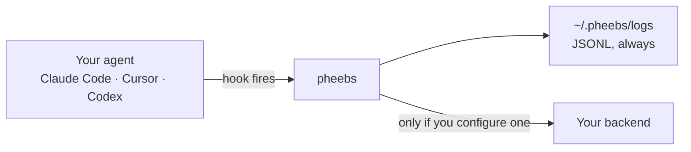

<div>
  <picture>
    <source media="(prefers-color-scheme: dark)" srcset="https://www.eversynced.com/assets/pheebs-lockup-animated-dark.webp">
    
  </picture>

  <br/>
</div>

**Open-source, local-first telemetry for AI coding agents. See how Claude Code, Cursor, and Codex
are actually used, without capturing code or prompts.**

[](https://www.npmjs.com/package/pheebs)
[](https://github.com/Eversynced/pheebs/actions/workflows/ci.yml)
[](./LICENSE)

[pheebs.ai](https://pheebs.ai) · [npm](https://www.npmjs.com/package/pheebs) ·
[AI Proficiency Model](./docs/ai-proficiency-model.md) · [Privacy](./PRIVACY.md)

## What Pheebs is

Pheebs is an open-source, local-first telemetry CLI for AI coding agents (Claude Code, Cursor,
and Codex). It installs as hooks in your agent, writes one JSONL line per event to your machine,
and reports on how you work with the agent, right in your terminal.

Adoption numbers say who has access. They say nothing about what happens inside a session: which
models get used and whether the model used was the best fit for the work, how much a team could be
saving by running smaller models where they would do, whether tests run before a commit, how often
work goes through a review pass, whether AI output gets questioned or accepted wholesale, which
skills, sub-agents, and MCP servers are actually in play. Pheebs captures that.

It sends nothing anywhere until you point it at a backend you control (or opt in to classifying
prompts through your own Claude Code login). No source code, no prompts, no file paths.



Pheebs reads the data it captures through the [AI Proficiency
Model](./docs/ai-proficiency-model.md), in two layers: **Layer 1: harness repertoire**, which
harness capabilities are in play, and **Layer 2: judgement signals**, how well AI output gets
verified, challenged, and refined before it ships. The model is its own versioned document, so it
can evolve in the open and be adopted beyond Pheebs. The event schema stays independent of it.

Built by [Eversynced](https://eversynced.com), a nearshore engineering company.

## Quick start

You need Node.js 20 or later on macOS, Linux, or Windows, and one of Claude Code, Cursor, or Codex
with hooks support. A git repository is recommended: Pheebs reads the `org/repo` codebase id from
its remote, and falls back to the folder name without one.

```bash
npm install -g pheebs   # 1. install
pheebs init             # 2. register hooks in the current repo (Claude Code)
                        # 3. use your agent as usual
pheebs insights         # 4. read your own report
```

Installing does **not** configure anything, so run `pheebs init` next. It asks for a backend
endpoint and a token; leave both blank and Pheebs stays local-only. Add `--cursor` or `--codex` to
configure the other tools. Pheebs then fires in the background during your sessions, and nothing
changes about how you work.

No backend is needed to get a report: with none set, `pheebs insights` reads your local log.

CI runs on macOS, Linux, and Windows. One Windows capture question is still open: whether Claude
Code's `PowerShell` tool carries its command where Pheebs reads it, so test and commit detection
there is unconfirmed (see the [findings ledger](./docs/spike-findings-ledger.md)).

## What you'll see

`pheebs insights` prints your engineer view of both layers. With mock numbers for Pam, who works in
Claude Code only:

```
$ pheebs insights
Your last 28 days

Repertoire

Competency          State      % recurring
------------------------------------------
Models              Recurring          33%
Artifacts           Recurring          33%
MCP                 Recurring         100%
Evals               Recurring          60%
Context management  Recurring          50%
Orchestration       Adopted             0%

Coverage index: 9 / 23 = 39%
█████████░░░░░░░░░░░░░░

Sessions: 66 over 4 active week(s)
Compaction: 12 auto, 3 manual

Judgement signals

Signal                          You  Team median
------------------------------------------------
Verification coverage           62%          48%
Pushback rate                    9%          14%
Refinement-to-repair ratio  2.1 : 1      1.4 : 1
Wholesale-accept rate           21%          33%
Model-fit rate                  35%          55%

Trend, weekly
Signal                        First             Latest
------------------------------------------------------
Verification coverage           44%  ▁▂▃▄▅▆▆▇      62%
Pushback rate                    7%  ▃▁▃▅▃▃▅▇       9%
Refinement-to-repair ratio  1.6 : 1  ▁▂▁▂▃▅▆▇  2.1 : 1
Wholesale-accept rate           29%  ▇▆▆▅▃▃▂▁      21%
Model-fit rate                  28%  ▁▂▄▄▄▅▆▇      35%

Model fit, split: 66 complete sessions
Fit               23
Over-provisioned  41
Under-powered      2

Repair-heavy sessions: 6, read as
  Little context up front  3
  Model below the work     1
  Hard, open-ended work    1
  No reading               1

A correlation over provisional thresholds: one session says little, a pattern
over weeks says more.

Cost

Could have run cheaper
  claude-sonnet-5  $125.00  over 41 session(s)
    API list-price equivalent, estimated upper bound
```

The competency states are the profile and the coverage index is the trend line. What each
practice and signal means is defined in the [AI Proficiency Model](./docs/ai-proficiency-model.md).

## Supported tools

| Tool | Status | Hook entries |
|---|---|---|
| **Claude Code** | Fully supported | 15 entries across 14 hook types |
| **Cursor** | Supported | 13 entries across 13 hook types |
| **Codex** | Fully supported | 10 entries across 10 hook types |

**Fully supported** = hooks + OpenTelemetry metrics. **Supported** = hooks only.

All tools share the same log format and remote transport. The `ai_tool` field identifies the source.

## Privacy

### What Pheebs does not capture

This part matters:

- No source code or file contents
- No file paths or directory structures
- No prompt text, except through classification (see below)
- No command strings: `npm test` is read in-process and recorded as `tool_intent: "test_run"`
- Developer identity is your token's id once the token is validated, otherwise a truncated hash of your git email

Pheebs is about interaction patterns, not surveillance.
[`PRIVACY.md`](./PRIVACY.md) documents every field against the source.

**By default, no telemetry leaves your machine.** No backend endpoint comes with the client, so a
fresh install writes JSONL to `~/.pheebs/logs/` and sends no event, prompt, or OpenTelemetry data
anywhere. Sending requires setting an endpoint (`pheebs config set base-url <url>`) and a token.
Two opt-in exceptions are named in [`PRIVACY.md`](./PRIVACY.md): a once-a-day update check, and
`classify local`, which sends each Claude Code prompt to Anthropic through your own `claude -p`.

Read your own data at any time. It is plain text:

```bash
tail -qn 20 "$(ls -t ~/.pheebs/logs/*.jsonl | head -1)"
```

On Windows, in PowerShell:

```powershell
Get-Content -Tail 20 (Get-ChildItem ~/.pheebs/logs/*.jsonl | Sort-Object LastWriteTime | Select-Object -Last 1).FullName
```

### Prompt classification: the one exception

On each prompt, Pheebs can send the prompt text to your backend's `/classify-prompt` route, which
returns a single intent label such as `implement` or `debug`. This is the only feature that sends
raw content off your machine, so it is worth stating plainly what gates it.

It requires **all** of: classification enabled (default on), a backend endpoint configured, a
stored token, and that token's tenant carrying `prompt_collection` consent. No prompt text is sent
unless every one holds. With classification off the event carries no `prompt_intent` field at all;
with it on but something else missing, the event records `prompt_intent: "unclassified"`.

Only the returned label is stored. The prompt text is never written to your log.

`pheebs config set classify local` classifies Claude Code prompts on your machine instead, through a
headless `claude -p` under your own login, so no prompt reaches the backend. See
[`PRIVACY.md`](./PRIVACY.md#local-mode).

Turn it off entirely:

```bash
pheebs config set classify off
```

With consent enabled the honest guarantee is not "prompt text never leaves the machine". It is
"prompt text reaches the backend you configured, is classified into one word, and is not stored by
Pheebs." What that backend does with it is a property of that backend. See
[`PRIVACY.md`](./PRIVACY.md).

## Insights

```bash
pheebs insights            # your recent work, in the terminal
pheebs insights --days 7   # a narrower window, 1 to 365
pheebs insights --json     # the raw payload, for scripting
pheebs insights --local    # from this machine's log only, even with a backend set
```

Your own data only: which practices you actually use, what happens to AI output before it ships,
and what your model choices cost. No peer comparison and no leaderboard. The one team number is a
median, which answers "is this normal here" without naming anyone.

With no backend set, or with `--local`, the report reads your local log, makes no request, and
reports your harness repertoire and judgement signals over the last 30 days. It says it is local
before anything else, and `--json` marks the payload `"local": true`. With a backend set, it reads
the backend's optional `GET /insights` route instead, over the backend's window.

A section that cannot be produced says so in one line and gives the reason, rather than reporting a
zero that reads like a measurement.

Managers can read the same model across their tenant:

```bash
pheebs insights --team            # adoption, heatmap, team stats, signals by engineer, spend
pheebs insights --team --days 28  # a different window
pheebs insights --team --json     # the raw payload, for scripting
```

This reads `GET /insights/team` and needs a backend and a manager token from an admin.
`pheebs --help` lists `--team` once a manager's token has been set, so after a promotion re-run
`pheebs config set token`; the flag works either way. Anyone else gets a plain refusal, because the
backend checks the role on every call. Developers who opted out are never a row in the two tables
that name people, and each says how many were withheld. A view the backend cannot produce says why
in one line rather than printing zeros.

## Setup in detail

### What `init` asks for

`pheebs init` registers Claude Code hooks (and OpenTelemetry) in `.claude/settings.local.json` in
the current repo, and asks for:

- **the backend endpoint**: blank by default. Leave it blank and Pheebs stays local-only: events
  are written to `~/.pheebs/logs/` and nothing leaves your machine. Set it to send events to a
  backend;
- **your Pheebs API token**: provisions your developer identity and authenticates telemetry (get
  one from an admin; you can skip and set it later with `pheebs config set token <token>`).

Telemetry (both event ingest and OpenTelemetry) only leaves your machine once **both** an endpoint
and a token are set.

### Scope

`init` is project-local by default, so instrumentation is opt-in per repo and your personal
projects stay out of the data.

When OpenTelemetry is on, the project file carries your token, so `init` adds it to the repo's
`.git/info/exclude` (local and uncommitted, unlike `.gitignore`) and tells you, having checked with
git that the entry took. Outside a repo it says nothing, since there is nothing to commit the token
into. It warns instead when git would still commit the file: most often because the file is
already tracked, which no ignore rule undoes. The same applies to `.codex/config.toml` on a
project-scoped Codex install.

To instrument every repo on the machine instead:

```bash
pheebs init --global
```

That writes `~/.claude/settings.json`. Pick one: Claude Code merges both files, so keeping a
user-level and a project-local install side by side fires every hook twice. `init` warns when it
finds both, and `doctor` checks both scopes and fails on a double install.

Because the default scope puts config in a file per repo, `init` records every path it writes in
`~/.pheebs/installs.json`, so `pheebs uninstall` and `pheebs config unset base-url` reach every repo
rather than only the current one. The file is local, holds nothing but paths pheebs itself wrote,
and is never sent anywhere.

So the way back to a single install is `pheebs uninstall` followed by the `init` you want.

### Multi-tool setup

To configure hooks for Cursor or Codex in addition to Claude Code:

```bash
pheebs init --cursor
pheebs init --codex
```

Each tool writes to its own config location, and they don't interfere with each other. Cursor
sessions are recorded only through the Cursor install: the Claude Code hook path ignores Cursor
payloads, so a Cursor session is never counted twice.

**Codex needs your trust first.** It reads `<cwd>/.codex/config.toml`, but drops the whole project
layer until you trust the project in its TUI, and skips any handler without a matching
`trusted_hash`. Both are your own security decision about a directory, so pheebs writes neither. A
project-local Codex install is inert until you grant that trust, and `init` and `doctor` both say
so.

### What the generated config looks like

**Claude Code** (`.claude/settings.local.json`, or `~/.claude/settings.json` with `--global`):

```json
{
  "hooks": {
    "UserPromptSubmit": [
      { "hooks": [{ "type": "command", "command": "pheebs hook prompt_submitted", "async": true }] }
    ],
    "PreCompact": [
      { "matcher": "auto", "hooks": [{ "type": "command", "command": "pheebs hook context_compacted --trigger-type auto", "async": true }] },
      { "matcher": "manual", "hooks": [{ "type": "command", "command": "pheebs hook context_compacted --trigger-type manual", "async": true }] }
    ]
  },
  "env": {
    "OTEL_METRICS_EXPORTER": "otlp",
    "OTEL_LOGS_EXPORTER": "otlp",
    "OTEL_EXPORTER_OTLP_PROTOCOL": "http/protobuf",
    "OTEL_EXPORTER_OTLP_ENDPOINT": "https://<your-pheebs-backend>/otel",
    "OTEL_EXPORTER_OTLP_HEADERS": "Authorization=Basic ..."
  }
}
```

Hooks that support multiple triggers (like `PreCompact`) register one entry per matcher. The `env`
block points Claude Code's native OpenTelemetry export at the Pheebs backend's OTLP proxy,
authenticated with your token.

### Verify

```bash
pheebs doctor            # checks Claude Code config, both scopes
pheebs doctor --cursor   # checks Cursor config
pheebs doctor --codex    # checks Codex config
pheebs doctor --global   # checks user-level config only
pheebs doctor --project  # checks project-local config only
```

Reports whether all expected hook entries are registered correctly. With a backend and a token
set, it also shows the send queue: how many events are waiting, how long the oldest has waited,
and the last problem sending them. Events normally leave within a minute, and at once when a turn
or session ends; if they pile up, fix what doctor reports, then run `pheebs flush` to send them at
once. A fix that changes `base-url` or the token discards what was queued for the old one; the
local log still has those events.

### Uninstall

Run `pheebs uninstall` before removing the package. It clears the hook entries and the exporter
config from every scope and every repo `init` wrote to, using the paths recorded in
`~/.pheebs/installs.json`.

Do this first: npm 7 and later do not run uninstall scripts, so `npm uninstall -g pheebs` removes
the binary and leaves every instrumented repo calling a command that is gone.

## Configuration

Pheebs works out of the box, and out of the box it is local-only. Settings are managed with
`pheebs config` and stored in `~/.pheebs/config.json` (the token lives separately in
`~/.pheebs/.token`, `0600`, or an owner-only ACL on Windows):

```bash
pheebs config list                 # show every setting and where it comes from
pheebs config get <key>            # print one setting's value
pheebs config set base-url <url>   # point at a different backend endpoint
pheebs config set auto-update on   # opt in to the once-a-day background self-update
pheebs config set classify off     # stop sending prompts to the intent classifier
pheebs config set token <token>    # store + validate your Pheebs API token
pheebs config unset <key>          # reset a setting to its default (or clear the token)
```

| Setting | Default | Description |
|---|---|---|
| `base-url` | _(unset, local-only)_ | The backend endpoint. Unset means nothing is sent. |
| `auto-update` | `off` | Once-a-day background self-update. Off by default: it installs in a detached, silent process, so it is opt-in. `pheebs doctor` reports when a newer version exists. |
| `classify` | `on` | `on` sends prompts to the backend intent classifier; `local` classifies Claude Code prompts on-machine through your own Claude Code login; `off` disables it |
| `token` | unset | Your Pheebs API token (identity + auth) |

Two working-directory settings are still environment variables (not persisted config):

| Variable | Default | Description |
|---|---|---|
| `PHEEBS_CODEBASE_ID` | Auto-detected from `git remote` | Override the `org/repo` identifier |
| `PHEEBS_LOG_PATH` | `~/.pheebs/logs/` | Where local JSONL logs go |

Local logs are daily files, one per codebase:

```
~/.pheebs/logs/Eversynced--pheebs-2026-03-13.jsonl
```

## CLI reference

```
pheebs init [--global] [--cursor|--codex] [--no-otel]
pheebs doctor [--global|--project] [--cursor|--codex]
pheebs config <list | get <key> | set <key> <value> | unset <key>>
pheebs insights [--days <n>] [--json] [--team | --local]
pheebs scan [--cursor|--codex]
pheebs flush
pheebs update
pheebs uninstall
pheebs hook <event_name> [--trigger-type <type>]
pheebs hook-cursor <event_name>
pheebs hook-codex <event_name>
```

| Command | Description |
|---|---|
| `init` | Register hooks (and OTel config) for the current repo, configure the endpoint, and set your token |
| `init --global`, `-g` | Write to user-level config instead of project-local |
| `init --cursor` | Configure Cursor hooks |
| `init --codex` | Configure Codex hooks |
| `init --no-otel` | Skip OpenTelemetry configuration |
| `doctor` | Verify hooks in both scopes, the endpoint, your token status, and the send queue |
| `doctor --project`, `-p` | Check only the project-local config (`--global` checks only user-level) |
| `insights` | Render your own report from the local log, or from the backend's `/insights` when one is set |
| `insights --days <n>` | Set the window, 1 to 365 (default: 30 days locally, the backend's window otherwise) |
| `insights --json` | Print the raw `/insights` payload, or the local report marked `"local": true`, for scripting |
| `insights --local` | Render from the local log with no request, even with a backend set |
| `insights --team` | Render the team report from `/insights/team` (manager tokens only; combines with `--days` and `--json`) |
| `scan` | Scan the current repo for AI-config artifacts, recording presence and counts, never paths or contents |
| `flush` | Send queued events to the backend now, instead of waiting for the background sender |
| `update` | Update pheebs to the latest npm release |
| `uninstall` | Remove pheebs hooks and OTel config from every scope and every repo `init` wrote to |
| `config list` | Show all settings and their source |
| `config get <key>` | Print one setting's value |
| `config set <key> <value>` | Set `base-url`, `auto-update`, `classify`, or `token` |
| `config unset <key>` | Reset a setting to its default (clears the token) |
| `hook <event>` | Handle a Claude Code hook event (called by hooks, not manually) |
| `hook-cursor <event>` | Handle a Cursor hook event |
| `hook-codex <event>` | Handle a Codex hook event |

## What Pheebs captures

### Claude Code

| Hook | Event | Extra fields | What Pheebs is looking at |
|---|---|---|---|
| `SessionStart` | `session_started` | `start_source`, `model` | How are sessions starting: fresh, resumed, or after a clear? |
| `InstructionsLoaded` | `instructions_loaded` | `load_reason`, `memory_type` | Is a context file (CLAUDE.md, rules) actually loaded, not merely present? The file's path is never read into the event. |
| `PostModelSwitch` | `model_switched` | `from_model`, `to_model`, `switch_source` | Do developers move between models mid-session, and what prompted the move? |
| `UserPromptSubmit` | `prompt_submitted` | `prompt_length` | How much context is front-loaded up front? `prompt_length` is the prompt's character count (the prompt text itself is never stored); size thresholds are applied downstream when charting. |
| `UserPromptExpansion` | `command_expanded` | `command_name`, `expansion_type`, `command_source` | Which slash commands / skills are being expanded? |
| `SubagentStart` | `subagent_spawned` | `agent_type`, `agent_id` | How often are subagents being delegated to, and what kind? |
| `SubagentStop` | `subagent_completed` | `agent_type`, `agent_id`, `stop_hook_active` | How do subagent runs end? |
| `PostToolUse` | `tool_use_completed` | `tool_name`, `duration_ms`, `subagent_model`, `agent_type`, `requested_model` (Agent calls) | Which tools are used and how long do they take? Which model did a subagent run on? |
| `PostToolUseFailure` | `tool_use_failed` | `tool_name`, `duration_ms`, `is_interrupt` | Which tools fail, and how much back-and-forth follows? |
| `PreCompact` (auto) | `context_compacted` | `trigger_type` | How deep do sessions get before the context overflows? |
| `PreCompact` (manual) | `context_compacted` | `trigger_type` | Are developers manually compacting, or only hitting the limit? |
| `TaskCreated` | `task_created` | `task_id`, `task_subject`, `teammate_name` | Are background tasks being used, and by whom? |
| `TaskCompleted` | `task_completed` | `task_id`, `task_subject`, `teammate_name` | Are background tasks part of the workflow? |
| `Stop` | `turn_ended` | `stop_hook_active`, `background_task_count`, `session_cron_count` | When do turns end, and what's running in the background? |
| `SessionEnd` | `session_end` | `reason` | When and why do sessions end? |

### Cursor

| Hook | Event | Extra fields | What Pheebs is looking at |
|---|---|---|---|
| `sessionStart` | `session_started` | `is_background_agent`, `effort`, `fast_mode` | How are sessions starting, are background agents involved, and how is the model configured? |
| `beforeSubmitPrompt` | `prompt_submitted` | `model`, `composer_mode`, `command_name`, `prompt_length`, `effort`, `fast_mode`, `rule_attachment_count` | What models/modes are used, which slash commands / skills are invoked, how much context is front-loaded, and are rules attached to the prompt? `command_name` is derived from a leading `/command` and `prompt_length` is the prompt's character count; the prompt text itself is never stored. `rule_attachment_count` counts attachments whose `type` is `rule`; the attachment's `file_path` is never read. |
| `subagentStart` | `subagent_spawned` | `agent_type`, `agent_id`, `subagent_model`, `is_parallel_worker` | How often are subagents being delegated to? |
| `subagentStop` | `subagent_completed` | `agent_type`, `status`, `subagent_duration_ms`, `tool_call_count` | How do subagent runs end? |
| `beforeShellExecution` | `tool_invoked` | `tool_name` | What tools is the agent reaching for? |
| `afterShellExecution` | `tool_use_completed` | `tool_name`, `duration_ms` | How long do tool calls take? |
| `beforeMCPExecution` | `tool_invoked` | `tool_name` | Are MCP tools part of the workflow? |
| `afterMCPExecution` | `tool_use_completed` | `tool_name`, `duration_ms` | How reliable are MCP tool calls? |
| `afterFileEdit` | `tool_use_completed` | `tool_name` | How often does the agent edit files? |
| `postToolUseFailure` | `tool_use_failed` | `tool_name`, `failure_type`, `is_interrupt` | Which tools fail, and why? |
| `preCompact` | `context_compacted` | `trigger_type`, `context_usage_percent`, `context_tokens` | How deep do sessions get before compaction? |
| `stop` | `turn_ended` | `status`, `loop_count`, `effort`, `fast_mode` | When do turns end, and how many loops did they take? |
| `sessionEnd` | `session_end` | `reason`, `session_duration_ms`, `is_background_agent` | When and why do sessions end? |

Cursor events also capture `conversation_id`, `generation_id`, `cursor_version`, `loop_count`, and token counts when available.

`effort` and `fast_mode` come from Cursor's `model_params` list, which rides on those three events and on no tool event. Cursor sends it **only from its GUI**. Its headless CLI carries no effort signal at all, so an absent `effort` on Cursor is as often the surface as an unset level. `fast_mode` is the vendor's undocumented `fast` setting, passed through verbatim as the string it arrives as.

### Codex

| Hook | Event | Extra fields | What Pheebs is looking at |
|---|---|---|---|
| `SessionStart` | `session_started` | `model`, `start_source`, `permission_mode` | How are sessions starting, and with what model? |
| `UserPromptSubmit` | `prompt_submitted` | `model`, `command_name`, `prompt_length`, `permission_mode` | How often are prompts submitted, which slash commands / skills are invoked, and how much context is front-loaded? `command_name` is derived from a leading `/command` and `prompt_length` is the prompt's character count; the prompt text itself is never stored. |
| `SubagentStart` | `subagent_spawned` | `agent_id`, `agent_type` | How often are subagents being delegated to? |
| `SubagentStop` | `subagent_completed` | `agent_id`, `agent_type`, `stop_hook_active` | How do subagent runs end? |
| `PreToolUse` | `tool_invoked` | `tool_name`, `tool_pattern`, `permission_mode` | What tools does Codex reach for? |
| `PostToolUse` | `tool_use_completed` | `tool_name`, `tool_pattern`, `permission_mode` | Do tool calls succeed? |
| `PermissionRequest` | `permission_requested` | `tool_name`, `permission_type`, `approved` | How often does the sandbox ask for permission? |
| `PreCompact` | `context_compacted` | `trigger_type` | How deep do sessions get before compaction? |
| `PostCompact` | `compaction_completed` | `trigger_type` | What happens after compaction? |
| `Stop` | `turn_ended` | `model`, `input_tokens`, `output_tokens`, `duration_ms`, `stop_hook_active`, `permission_mode` | Turn length and token usage. |

`permission_mode` is Codex's own sandbox/approval setting, recorded verbatim on the five events that carry it and absent on the two compaction events. It is captured as a raw fact, not as a reading of how a developer chose to work: its value is **constant per harness** rather than per session mode, and a session driven in plan mode does not report `plan`. Anything inferring deliberate autonomy choices from it would be wrong.

### Derived tags

On top of the raw fields, Pheebs adds a few coarse tags it derives in-process and then discards
the input: `tool_intent` (such as `test_run`) and `vcs_action` (such as a commit or a
`git worktree add`) from tool names and shell commands, `command_sequence` for the order and
operators of a chained shell command, `prompt_intent` and `task_scope` from prompt classification,
and `role` from a subagent's agent type. Every event also carries a time-ordered `event_id`, so a
backend can store a resend once. [`PRIVACY.md`](./PRIVACY.md) lists each field against its source,
and [`docs/architecture.md`](./docs/architecture.md) describes the envelope.

## How it works

When a hook fires, Pheebs:

1. Reads the hook payload from stdin
2. Pulls out session metadata (session ID, event type)
3. Runs a tool-specific extractor for relevant fields
4. Figures out who you are (your token's id, or a hashed git email without a token) and what repo you're in (`org/repo` from git remote)
5. Writes a JSONL line to a local log file
6. Queues it for the Pheebs backend, and a background `pheebs flush` sends the queue in batches (`POST <endpoint>/ingest/batch`, authenticated with your token). The backend stamps your identity from the token and stores it. No hook waits on the network to deliver an event. If no token is set, nothing is queued and only the local log is kept.

A log entry looks like this:

```json
{
  "timestamp": "2026-03-13T14:30:00.000Z",
  "source": "hook",
  "event": "context_compacted",
  "developer": "dev-3f9a1c",
  "codebase": "Eversynced/pheebs",
  "ai_tool": "claude_code",
  "session_id": "abc123",
  "trigger_type": "auto"
}
```

The `ai_tool` field identifies which tool generated the event. Extra fields vary by event:
`prompt_length` for prompts, `agent_type` for subagent spawns, `tool_name` for failures,
`trigger_type` for compaction, `start_source` for session starts. The base shape is always the
same.

For the full pipeline, the event envelope, and where a backend or a consumer plugs in, see
[`docs/architecture.md`](./docs/architecture.md).

### Telemetry (OpenTelemetry)

For tools that support native OpenTelemetry export (Claude Code, Codex), `pheebs init` also
configures OTLP export **through the Pheebs backend's `/otel` proxy**, authenticated with your
token. The backend forwards it to its observability backend, which adds metrics and logs alongside
the hook-based event data, and the client never holds an observability credential of its own.

OTel export activates only when both a backend endpoint and a token are set, and clearing either
one strips the exporter config again.

To skip OTel configuration:

```bash
pheebs init --no-otel
```

## FAQ

### Do I need a backend to use Pheebs?

No. Pheebs is local-only by default. It writes events to `~/.pheebs/logs/`, and
`pheebs insights` builds your report from that log. A backend is only needed to send events off
your machine, or for the manager's `--team` report.

### Does Pheebs send my code or prompts anywhere?

No source code, file paths, or command strings from your sessions are ever stored or sent. Prompt text is only sent
for classification, and only when you have configured a backend with consent, or opted in to
`classify local`. Even then only the one-word label is stored. See [Privacy](#privacy) and
[`PRIVACY.md`](./PRIVACY.md).

### Which AI coding agents does Pheebs support?

Claude Code, Cursor, and Codex. See [Supported tools](#supported-tools).

### What does `pheebs insights` measure?

Your engineer view of the [AI Proficiency Model](./docs/ai-proficiency-model.md): Layer 1, your
harness repertoire (which practices across models, artifacts, MCP, evals, context management, and
orchestration you use), and Layer 2, your judgement signals (verification coverage, pushback,
refinement-to-repair, wholesale-accept, and model fit). See [What you'll see](#what-youll-see).

### Will Pheebs slow down my agent?

No. On Claude Code the hooks run asynchronously. On Cursor and Codex any network call is bounded
by a timeout, and events are sent by a detached background process rather than from the hook.
Remote failures degrade silently and never reach your session.

### Does Pheebs instrument every repo on my machine?

Only with `pheebs init --global`. The default is per repo, so your personal projects stay out of
the data. See [Scope](#scope).

### How do I uninstall Pheebs?

Run `pheebs uninstall` first, then `npm uninstall -g pheebs`. See [Uninstall](#uninstall).

## Contributing

See [`CONTRIBUTING.md`](./CONTRIBUTING.md) for the gate and the submission flow,
[`SECURITY.md`](./SECURITY.md) to report a vulnerability, and
[`CODE_OF_CONDUCT.md`](./CODE_OF_CONDUCT.md).

Building your own backend? The contract is [`openapi.yaml`](./openapi.yaml) plus
[`docs/backend-contract.md`](./docs/backend-contract.md), and there is a runnable reference
implementation in [`examples/`](./examples/).

## License

[Apache-2.0](./LICENSE).
