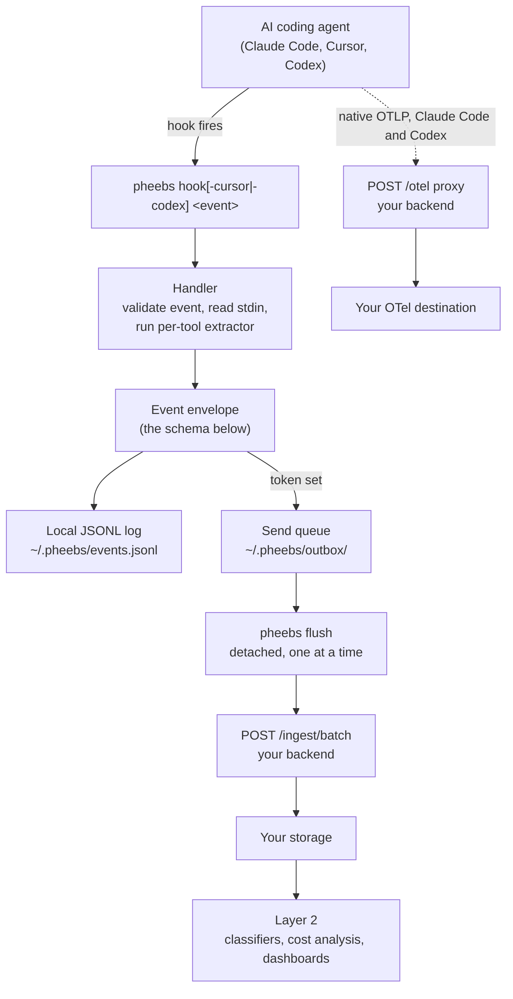

# Architecture

How an agent event becomes a row you can query, and where your own code plugs in.

## The pipeline



Cursor also runs the hooks in a project's `.claude/settings.json`. Pheebs records Cursor
sessions only through its Cursor install (`pheebs init --cursor`), so the Claude Code path ignores
those payloads rather than logging them as `claude_code` (`isCursorPayload` in
[`src/hooks/handler.ts`](../src/hooks/handler.ts)).

Local logging always happens. The send is skipped entirely when no
endpoint and token are configured, which is the default: Pheebs ships local-only.

## Delivery

No hook waits on the network to deliver an event. It writes the envelope to the send queue, one
file per event, and starts a detached `pheebs flush` unless one is already running or a backoff
is pending, then exits.
Cursor and Codex wait for the hook process, so this is what keeps a slow or unreachable backend
from stalling them ([`src/transports/http.ts`](../src/transports/http.ts)). Prompt
classification is the one call a hook still makes, bounded at 2.5 seconds.

The flusher lets the oldest event wait up to a minute, so one request carries a burst of hooks,
unless a `turn_ended` or `session_end` is queued, or a prompt written seconds after its own
timestamp because its classifier held it up, which it sends at once along with everything
ahead of it. It then sends batches to `POST /ingest/batch` until the queue is empty, falling back
to `/ingest` on a backend that does not batch ([`src/flusher.ts`](../src/flusher.ts)). What it retries, and
what a backend owes a resend, is in [`backend-contract.md`](./backend-contract.md).

Each backend and token gets its own queue, and pointing Pheebs elsewhere discards the old one
rather than send it to a backend the events were never meant for
([`src/outbox.ts`](../src/outbox.ts)). The local log keeps every event either way.

### Token usage

A Claude Code transcript carries the tokens a session used. No hook reads one: a hook on a session start, a turn end or a session end only records the session
(id, tool, codebase, timestamps, never a path) in `~/.pheebs/sessions/` ([`src/usage-sessions.ts`](../src/usage-sessions.ts)). The detached flusher
finds and reads the transcript of every recorded session that has ended, or has been quiet for 30 minutes,
which is the sweep for sessions that never sent `session_end`
([`src/usage-collect.ts`](../src/usage-collect.ts)). It sums the tokens by model and queues one
`session_token_usage` event per model and scope, as a delta since the last read, then moves the
session's byte offsets forward. The readers are in [`src/transcript-usage.ts`](../src/transcript-usage.ts):
it counts each `message.id` and `requestId` once, skips a request another session's file already counted
(a background, resumed or forked session's file starts with a copy) and a line that names another session
as the requester, never counts a line stamped before the session was first seen or not stamped at all,
and adds the subagent files below the transcript. Cursor has no reader, because its transcripts carry no usage, and Codex is not read (see the
[ledger](./spike-findings-ledger.md)).

The lookup searches `CLAUDE_CONFIG_DIR`, `~/.claude` and each `~/.claude-*` directory with a
`projects` folder, one folder level down. A transcript in a config directory outside those is not found, and its
usage is never sent: a known limit. A transcript not found yet is searched for again every 10
minutes until the record expires after 30 days. A session record carries a hash of the backend
endpoint (the configured base URL) it was recorded under, and the flusher skips one recorded under
any other, so usage never goes to a backend it was not captured for. The record also keeps when Pheebs
first saw the session (`first_seen`), through every later note and through a change of backend, so a
session resumed after the install sends only what it did from then on, never the history in its file. A token rotated on the same
endpoint changes nothing: a session that ended but was not read yet is still sent, to the queue of
the token now configured, and the flusher only runs while a backend and token are configured. A
session with no `session_end` is read only when its transcript has also gone quiet for 30 minutes.

The flusher keeps everything else in one file, `usage-state.json` beside the records: the byte
offsets of each session (a mark, kept 180 days after its record goes, so a resumed session carries on
from its old offsets, 50,000 at most) and, for each request counted, a 16-character digest of its ids
with a digest of the file that counted it, never an id or any text, so a later file that repeats
the request is skipped (an entry goes after 180 days, 250,000 at most, oldest dropped first). The file
names the endpoint it was built for. When the endpoint differs, the marks and the claims go together
and every session is read from offset 0, but a line stamped before the session's `first_seen` is still
not counted, so the new backend receives the session from when Pheebs first saw it, once, then only
what is added. No history of the earlier endpoint is kept: going back to it resets again and
sends the session to it again from `first_seen`. The hook cannot share that file, since hooks run at once in
many sessions and must never wait on a lock, so each session keeps its own small record, which only
a hook writes. A flusher takes a lock around each pass, and one that finds it taken skips the pass,
so two flushers cannot overwrite each other's marks or claims. For N sessions that is N records and
one state file, plus the lock while a pass runs. `pheebs uninstall` removes all of it. Read order
decides which session is credited with a shared request, and moves the output total slightly (426
tokens in one recount, cause unverified).

Known limit: if the flusher dies after queuing a session's events and before saving the state at the
end of the pass, and the transcript grows before the next read, the overlap is sent again under new ids and counted
twice.

## The client's job, and where it stops

Pheebs emits generic facts about an interaction: a tool ran with intent
`test_run`, a VCS write action of kind `commit` happened, a session started.
Each is stamped with `session_id`, `developer`, `codebase`, `ai_tool`, and
`timestamp`.

It does not correlate events. Hooks are stateless single-shot processes, so a
hook invocation cannot know what happened earlier in the session. Correlation
is the consumer's job, and that boundary is deliberate: it keeps the event
schema unopinionated and lets any number of consumers compose the same facts
differently.

The rule that follows: Pheebs never emits goal-shaped metrics. No
`tier_3_detected`, no scores, no verdicts. It emits facts; a consumer composes
them.

## The event envelope

Every event, from every tool, has the same base shape:

```json
{
  "timestamp": "2026-03-13T14:30:00.000Z",
  "source": "hook",
  "event": "context_compacted",
  "developer": "dev-3f9a1c",
  "codebase": "Eversynced/pheebs",
  "ai_tool": "claude_code",
  "session_id": "abc123",
  "event_id": "0192a8f0-4c1e-7d3a-9b2f-6e5d4c3b2a10",
  "trigger_type": "auto"
}
```

The typed fields are `timestamp, source, event, developer, codebase, ai_tool,
session_id, version, event_id`. `event_id` is a UUIDv7 minted for each event and kept
across resends, so a backend can store a retried batch once. Everything tool-specific or
event-specific rides alongside them as extras: `tool_intent`, `vcs_action`, `command_sequence`, `command_name`, `lines_changed`,
`agent_type`, and so on. `ai_tool` says which agent produced the event.

`developer` is stripped by the client before the send. The backend stamps
identity from the token instead, so the transport never carries a claimed
identity.

## The contract

[`openapi.yaml`](../openapi.yaml) at the repo root is the normative description
of the routes a backend must implement. [`backend-contract.md`](./backend-contract.md)
carries the failure semantics and the reasoning that a schema cannot express:
what a 4xx means, what is optional, what a compliant implementation may not do.

Read them together. The spec says what the shapes are; the contract doc says
what the behavior must be. A runnable implementation of both lives in
[`examples/backend-node/`](../examples/backend-node/).

## Where Layer 2 plugs in

Anything that scores, classifies, costs, or ranks is Layer 2: a consumer of the
contract, never a driver of the schema. It reads the stored events and composes
them. A field that only makes sense to one consumer's scoring model does not
belong in an event.

Two integration points exist for consumers that need more than stored rows:

- **`/classify-prompt`**, an optional backend route. When tenant consent is
  present, the client sends the raw prompt and attaches the returned
  `prompt_intent` to the event. It is best-effort and bounded: it degrades to
  `prompt_intent: "unclassified"`, sends no prompt text on failure, and never
  blocks the hook. With `classify local` the client classifies Claude Code
  prompts itself through a headless `claude -p` and never calls this route.
- **`/insights`**, an optional backend route for a consumer that computes
  repertoire or judgement-signal sections over the stored events.

Both are described in [`backend-contract.md`](./backend-contract.md).

## Composing events into metrics

Consumer-side correlation has a few rules that are properties of the capture
layer, not preferences. They apply to any storage engine.

**Anchor on `tool_use_completed` and `tool_use_failed`, never `tool_invoked`.**
Cursor and Codex fire `tool_invoked` for the same execution that later produces
a completion event, so including it double-counts.

**Pass and fail are uniform across all three tools.** Claude Code and Cursor
fire `tool_use_failed` on a failed call and `tool_use_completed` on success.
Codex has no failure hook, so the handler derives the outcome from the raw tool
result and rewrites the event to `tool_use_failed`. A `test_run` on
`tool_use_completed` passed; on `tool_use_failed` it failed. Test-gated
ship counts a test of either outcome, because running the tests is the gate.

**Correlation never crosses `session_id`.** A test run in one session and a
commit in another are unrelated, and treating them otherwise invents a
sequence that did not happen.

A worked example, a test-gate ratio: for each VCS write action, carry forward
the timestamp of the most recent test run in the same session, whatever its
outcome, and call the action gated when one falls inside a short preceding
window. A ship whose own row's `command_sequence` shows a test linked to it by
`&&` alone is also gated: no earlier row can show that, and the window excludes
the current row so `git push && npm test` does not gate itself.

```sql
WITH stream AS (
  SELECT
    session_id, developer, codebase, ai_tool,
    timestamp::timestamptz AS ts,
    event,
    extras->>'tool_intent' AS intent,
    extras->>'vcs_action'  AS vcs_action,
    extras->>'command_sequence' AS command_sequence
  FROM events
  WHERE event IN ('tool_use_completed', 'tool_use_failed')
    AND (extras->>'tool_intent' = 'test_run'
         OR extras->>'vcs_action' IN ('commit', 'push', 'pr_create'))
),
tagged AS (
  SELECT *,
    max(ts) FILTER (WHERE intent = 'test_run')
      OVER (PARTITION BY session_id ORDER BY ts
            ROWS BETWEEN UNBOUNDED PRECEDING AND 1 PRECEDING) AS last_test_ts
  FROM stream
)
SELECT
  session_id, developer, ts AS vcs_ts, vcs_action,
  (coalesce(command_sequence ~ '(test_run)( && [a-z_]+)* && (commit|push|pr_create)', false)
   OR (last_test_ts IS NOT NULL
       AND ts - last_test_ts <= interval '10 minutes')) AS test_gated
FROM tagged
WHERE vcs_action IN ('commit', 'push', 'pr_create')
  AND event = 'tool_use_completed';
```

The same window-function shape derives fix loops (a failing test run, then an
edit, then a passing test run in one session) by carrying forward two
timestamps instead of one.

### What limits these metrics

- **The time window is a heuristic.** Ten minutes is a guess at "this test run
  belongs to this change". Widen it for slow suites, narrow it to reduce
  coincidental pairings.
- **Chained commands are read segment by segment.** Every segment of a chain is
  classified, quoted text, comments and heredoc bodies are ignored, and a check
  (`test_run`, `typecheck`, `lint`, `build`) anywhere in the chain sets
  `tool_intent`. `vcs_action` is set whenever a write ran, whatever the
  `tool_intent`, and the strongest wins: `git add -A && git commit && git push`
  reports `push`, and `git commit -m x && git push && npm run build` reports
  `build` with `push`. The chain's exit status belongs to the whole chain, not to
  the check, so `npm test || true` reports a passing test run. The table is
  `COMMAND_KEYWORDS` in [`src/hooks/intent.ts`](../src/hooks/intent.ts).
- **`command_sequence` keeps the order a chain collapses.** A shell row with two
  or more segments carries each segment's tag, joined by the operators that
  separated them: `test_run && push`, `test_run ; push`, `test_run | other && push`.
  A segment's tag is its write action (`worktree`, `commit`, `push`, `pr_create`) when it is
  one, else its intent. The operators are `&&`, `||`, `;`, `|` and `&`, and a
  newline reads as `;`. It is absent for a single command, and stops at 32
  segments. It holds tags and operators, never command text. Pheebs does not
  decide a chain was gated: a reader of `test_run && push` and `test_run ; push`
  makes that call.
- **The same-row gate credits the row's strongest write.** The rule asks only
  that some write follow the test through `&&` links, while `vcs_action` reports
  the strongest write in the row. So `npm test && git commit -m x; git push`
  reads as a gated push, though only the commit was gated.
- **Codex outcome coverage is a lower bound.** Codex `PostToolUse` intercepts
  simple shell calls only, not `unified_exec` and not non-shell tools. Failures
  on uninstrumented calls never reach a hook. Claude Code and Cursor emit a
  dedicated failure event and are not subject to this gap.
- **Some fields are absent rather than zero.** `lines_changed` stays unset when
  the shape is unrecognized, and `rule_attachment_count` is omitted for a
  rule-less list, because a `0` would be indistinguishable from a surface that
  does not populate the field. Treat absent and zero as different.

Findings of this kind are recorded in
[`spike-findings-ledger.md`](./spike-findings-ledger.md) as they are verified.
